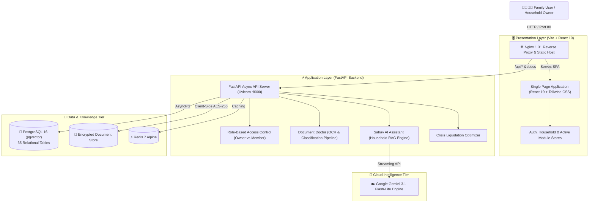

# SAHAY — The Household Life-Admin OS
### *One Unified, Zero-Knowledge Operating System for Indian Families*

[](http://16.178.56.236/)
[](http://16.178.56.236/docs)
[](http://16.178.56.236/)
[-336791?logo=postgresql)](http://16.178.56.236/)
[](http://16.178.56.236/)
[](http://16.178.56.236/)

---

## 🌐 Live Hackathon Deployment
- **Live Web Application:** [http://16.178.56.236/](http://16.178.56.236/)
- **Live Swagger API & Schema Docs:** [http://16.178.56.236/docs](http://16.178.56.236/docs)
- **Production Server:** AWS EC2 (Ubuntu 24.04 LTS, Docker Compose, Nginx Reverse Proxy)

---

## 👥 Hackathon Team: BrainByte
| Team Member | Role & Responsibilities |
|---|---|
| **Nagasuri Venkata Satya Dheeraj** | **Team Lead & AI Development** — Household RAG Engine, Gemini 3.1 Orchestration, Emergency Liquidation Logic & System Design |
| **Harshini Alamuru** | **Frontend & UI/UX** — Modern Clean Light-Themed Web Shell, Interactive Dashboards, Modal Engines & User Experience |
| **Tarun Teja Nagula** | **Backend & Security Layer** — FastAPI Micro-framework, PostgreSQL Schema Architecture, AES-256-GCM Encryption, Audit Vault & AWS Infrastructure |

---

## 📑 Table of Contents
1. [Project Overview & Problem Statement](#1-project-overview--problem-statement)
2. [High-Level Architecture](#2-high-level-architecture)
3. [The Seven Core Modules](#3-the-seven-core-modules)
4. [Screenshots & Visual Tour](#4-screenshots--visual-tour)
5. [Technical Implementation Deep Dive](#5-technical-implementation-deep-dive)
6. [Security & Privacy Architecture](#6-security--privacy-architecture)
7. [AWS Cloud Deployment Guide](#7-aws-cloud-deployment-guide)
8. [Local Development Setup](#8-local-development-setup)
9. [Future Roadmap & Impact](#9-future-roadmap--impact)

---

## 1. Project Overview & Problem Statement

### 1.1 The Reality of Indian Household Administration
In every Indian household, family administration is scattered across disconnected, fragile silos:
- **Scattered Critical Documents:** Identity proofs (Aadhaar, PAN), property deeds, vehicle RCs, and insurance policies are buried in physical drawer files or lost in WhatsApp chats.
- **Unnoticed Expiries & Penalties:** Vehicle insurance, term renewals, fixed deposit maturities, and medicine refills lapse quietly, resulting in hefty penalties and lost coverage.
- **Fragmented Health History:** In medical emergencies, family members scramble to locate blood groups, chronic illness histories, past prescriptions, and active medications.
- **Goal Blindness:** Savings for child education, marriage, or housing are planned in silos without real-time tracking of run-rate risk or household cash flow surplus.
- **The Panic of Crisis (₹5L Medical / Pandemic Emergency):** When an urgent calamity strikes (requiring ₹5,00,000 immediately), families experience severe panic, having no instant intelligence on which savings vaults to liquidate first without incurring irreversible surrender charges or tax penalties.

### 1.2 The SAHAY Solution
**SAHAY (The Household Life-Admin OS)** is a private, permission-governed operating system built specifically for Indian families. It brings every document, recurring bill, health vitals chart, and goal vault into a single interconnected command center powered by **Google Gemini 3.1**.

```
[Family Documents] ──┐
[Bills & Recurring] ─┼──>  [SAHAY KNOWLEDGE CORE]  ──>  [Predictive Life Radar]
[Health Vitals]    ──┤        (PostgreSQL + RAG)   ──>  [Emergency Liquidation]
[Lakshya Savings]  ──┘                             ──>  [Zero-Knowledge Vault]
```

---

## 2. High-Level Architecture

### System Topology Diagram



---

## 3. The Seven Core Modules

| # | Module | Core Capability & Hackathon Innovation |
|---|---|---|
| **1** | **Overview & Foundation** | Complete household command dashboard, system phase status, and transparent explanation of architecture. |
| **2** | **Household & Family** | Multi-generational role segregation (`Owner`, `Adult`, `Elder`, `Teen`, `Child`) with dynamic cryptographic invitation codes. |
| **3** | **Sahay Daily** | Unified timeline tracking bills, EMIs, policy renewals, calendar views, and predictive life-event radars. |
| **4** | **Family Vault** | Client-side AES-256-GCM encrypted document management with granular view/edit/revoke permissions. |
| **5** | **Document Doctor** | 6-step AI pipeline (OCR, classification, regex validation, PII redaction) that converts messy PDFs & bank SMS texts into actionable obligations. |
| **6** | **Health Shield** | Centralized blood group registries, chronic allergies, medication schedules, and a single-click Emergency QR Mode. |
| **7** | **Lakshya Goal Vaults & AI Assistant** | Collaborative milestone tracking with a mathematical Crisis Liquidation Optimizer (e.g. ₹5,00,000 emergency fund allocation without panic). |

---

## 4. Screenshots & Visual Tour

### 4.1 Dual-Track Registration Portal
Allows registration either as a **Household Owner** (initiates a new family vault) or as a **Family Member** (requires owner's cryptographic invite code).


---

### 4.2 Overview & Foundation Dashboard
The central command console displaying active household status, real-time database connection (`PostgreSQL`), and architecture highlights.


---

### 4.3 Household & Family Management
Role-based member directory with multi-role permissions, owner badge, spouse delegation, and dynamic 8-character invite code generation.


---

### 4.4 Sahay Daily — Unified Household Timeline
Tracks due dates, total pending amounts, 7-day outlook, and recurring utilities (electricity, water, broadband, rent, school fees).


---

### 4.5 Family Vault — Encrypted Document Repository
Encrypted document catalog categorizing Aadhaar, PAN, insurance, health records, and vehicle documents with member-specific access filters.


---

### 4.6 Document Doctor — AI Intelligence Pipeline
6-step autonomous pipeline converting raw documents and bank SMS alerts (e.g., Home Loan EMI, MSEB Electricity, LIC premium) into verified timeline obligations.


---

### 4.7 Health Shield & Emergency Mode
Digital health cards for all family members, vital baseline monitoring, allergy registries, active medications, and instant emergency share.


---

### 4.8 Lakshya Goal Vaults & Budget Run-Rate
Collaborative family goal tracking calculating household savings capacity, monthly surplus, milestone run-rates, and risk status.


---

### 4.9 Sahay AI Assistant (Household RAG & Crisis Liquidation)
Context-aware conversational assistant backed by Google Gemini 3.1 with pre-configured shortcuts for **Crisis Emergency Mode (₹5L)**, expense reduction, and bill summaries.


---

## 5. Technical Implementation Deep Dive

### 5.1 Technology Stack Matrix
- **Frontend Framework:** React 19 (TypeScript) bundled with Vite 5.
- **Styling & Design System:** Tailwind CSS with Lucide React iconography and full accessible light theme.
- **Backend Architecture:** FastAPI (Python 3.12) with asynchronous ASGI worker model (`uvicorn`).
- **ORM & Data Layer:** SQLAlchemy 2.0 with asyncpg driver and PostgreSQL 16 (pgvector).
- **AI Engine:** Google Gemini 3.1 via structured JSON schemas and prompt injection guardrails.
- **Security & Cryptography:** AES-256-GCM (via `cryptography`), bcrypt password hashing, and PyJWT authentication.
- **Reverse Proxy & Deployment:** Nginx 1.31 with Docker Compose on AWS EC2.

### 5.2 The Crisis Liquidation Optimization Algorithm
When a family urgently requires ₹5,00,000 for a hospital admission or crisis:
1. The engine queries all active goal vaults (`Emergency Fund`, `Car Fund`, `House Downpayment`, `Vacation`).
2. Calculates withdrawal availability in order of least financial penalty:
   $$\text{Priority 1: Emergency Liquid Funds} \longrightarrow \text{Priority 2: Discretionary Goals (Vacation/Car)} \longrightarrow \text{Priority 3: Sacred Goals (House/Education)}$$
3. Computes the replenishment run-rate:
   $$\text{Months to replenish} = \frac{\text{Amount Borrowed}}{\text{Monthly Free Cash Flow Surplus}}$$
4. Formulates a step-by-step restoration plan so the family can recover their goals post-crisis without permanently abandoning their dream milestones.

---

## 6. Security & Privacy Architecture

SAHAY is governed by **SAHAY Shield**, designed to prevent unauthorized family surveillance while ensuring seamless emergency accessibility:
- **Client-Side AES-256-GCM:** Document payloads are encrypted prior to persistence with unique initialization vectors (IV).
- **Zero-Knowledge Architecture:** No member (even within the same household) can read an encrypted document without explicit permission granted by the owner.
- **Strict Role-Based Compartmentalization:**
  - `Owner`: Full administrative rights, member invitation, budget control.
  - `Adult`: Access to shared bills, assigned goals, personal health profiles.
  - `Elder`: Simplified UI access, emergency health cards, medication reminders.
  - `Child`: Strictly restricted view; no access to financial documents or confidential IDs.
- **Immutable Audit Trail:** Every view, download, export, and edit is logged with client IP, timestamp, and action signature.

---

## 7. AWS Cloud Deployment Guide

The platform is running in production on AWS EC2 (`16.178.56.236`). Follow these steps to reproduce the exact cloud infrastructure:

### Prerequisites
- AWS EC2 Instance (t2.medium or t3.medium recommended, Ubuntu 24.04 LTS).
- Inbound Security Group Rules:
  - Port `80` (HTTP): `0.0.0.0/0`
  - Port `22` (SSH): Your IP / Anywhere

### Step-by-Step Auto-Deployment
```bash
# 1. Connect to EC2
ssh -i "your-key.pem" ubuntu@16.178.56.236

# 2. Clone the repository
git clone https://github.com/ndheeraj-shetty/sahay.git
cd sahay

# 3. Configure Production Environment
cp .env.production.example .env
nano .env  # Add your GEMINI_API_KEY and a secure SECRET_KEY

# 4. Launch with Auto-Deploy Script
chmod +x deploy_aws.sh
bash deploy_aws.sh
```

The script will automatically install Docker, compile Vite frontend assets, build the FastAPI backend container, initialize all 35 PostgreSQL schema tables, and launch Nginx.

---

## 8. Local Development Setup

To run SAHAY locally on your development machine (Windows, macOS, or Linux):

### 8.1 Backend Setup
```bash
# Navigate to backend directory
cd backend

# Create virtual environment
python -m venv .venv
source .venv/bin/activate  # On Windows: .venv\Scripts\activate

# Install dependencies
pip install -r requirements.txt

# Start FastAPI dev server (with hot reload)
python -m uvicorn app.main:app --host 127.0.0.1 --port 8000 --reload
```
API Documentation will be live at `http://127.0.0.1:8000/docs`.

### 8.2 Frontend Setup
```bash
# Navigate to frontend directory
cd frontend

# Install npm dependencies
npm install

# Start Vite dev server
npm run dev
```
Open `http://localhost:5173/` in your browser.

---

## 9. Future Roadmap & Impact

- [x] **Phase 1: Application Foundation & API Architecture** (Completed)
- [x] **Phase 2: Household & Multi-Member Permissions** (Completed)
- [x] **Phase 3: Client-Side Encrypted Family Vault** (Completed)
- [x] **Phase 4: Document Doctor OCR & Intelligence Pipeline** (Completed)
- [x] **Phase 5: Sahay Daily Unified Life Timeline & Calendar** (Completed)
- [x] **Phase 6: Health Shield Emergency QR & Medical Vitals** (Completed)
- [x] **Phase 7: Lakshya Goal Vaults & Crisis Liquidation Engine** (Completed)
- [x] **Phase 8: AWS EC2 Cloud Production Deployment & Verification** (Completed)
- [ ] **Phase 9: WhatsApp Bot Integration for Voice & Regional Language Inputs (Hindi, Telugu, Tamil, Marathi)**
- [ ] **Phase 10: Account Aggregator (RBI-AA) Integration for Automated Bank Statements**

---

<div align="center">
  <b>Built with ❤️ by Team BrainByte for the Hackathon</b><br>
  <i>Empowering Every Indian Family with Peace of Mind & Unified Intelligence</i>
</div>
